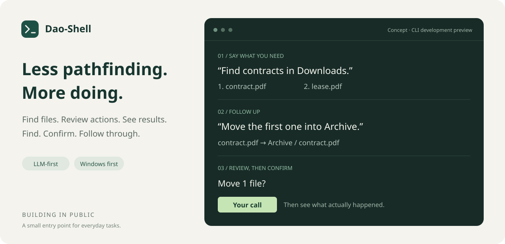

# Dao-Shell

[English](README.md) · [简体中文](README.zh-CN.md)

**A small, LLM-first shell for using your computer.**

Find local files, understand your computer and continue from real results. The Windows desktop preview combines a local overview with conversations and file search. A separate CLI supports guarded file moves.

[Try the preview](docs/GETTING_STARTED.md) · [Documentation](docs/README.en.md) · [Roadmap](ROADMAP.md) · [Share a use case](https://github.com/kestiny18/Dao-Shell/issues/new?template=use_case.yml)

_Interaction concept, not a running screenshot. File moves are a CLI capability. The desktop supports English and Simplified Chinese; CLI messages remain Chinese._

## What you can try

| Task | Windows desktop | CLI |
| --- | --- | --- |
| Find files | Natural language with a configured model, or literal file-name fallback | Natural language and direct search commands |
| Open a current result | Click to use the Windows default application without a second app confirmation | Local selection or model-requested confirmation |
| Understand the computer | CPU/memory rankings together, disk space, network interfaces, registered apps and a compact device profile | Resource and process observations |
| End a process | Explicit local confirmation for verifiable current-user instances | Not provided |
| Move a few files | Not provided | Reviewed, confirmed, same-volume moves with durable receipts |

The desktop has a fixed Overview tab, separate session tabs, remembered visible history and editable model/access/theme/language settings. Closing a tab preserves its session. Restart restores visible history, without replaying tools or restoring old candidates and confirmations.

The interface follows the Windows user's UI language: Chinese variants use Simplified Chinese; other or unknown languages use English. Choose **Settings → General & appearance → Interface language** to override this, then save. Existing user text, custom session titles, file paths and app names stay as written. New model requests follow the selected language unless the user explicitly asks for another language.

## Search and access

Restricted access searches selected, authorized folders. With Full access, a matching installed index component enables whole-volume name discovery on supported fixed local NTFS volumes. Installing or managing that component requires an explicit local action and Windows administrator permission; the desktop itself runs with ordinary permissions. Startup and search never install the component or request elevation automatically.

If the service is missing, incompatible or unavailable, searches use only the compatible folders listed in the receipt. Complex filters also use bounded folder searches while retaining their conditions. Coverage may be incomplete; receipts report scope, publication time and volume failures. Finding a name does not grant permission to inspect or open it: subsequent actions recheck access and file identity.

A direct click on a current candidate uses the system default `open` handler, including HTML and executable files. Executables may run with normal Windows semantics. Model-initiated opening still asks locally. Ending a process has a separate confirmation and may lose unsaved work; protected, changed or unverifiable identities are refused. App Uninstall opens Windows settings rather than executing a registry uninstall command.

## Preview status

This is an **unsigned Windows 10/11 x64 development preview**, not a stable release or completed independent acceptance. A local installer of about 9.1 MB has been built with an embedded WebView2 bootstrapper; an existing runtime is reused, while a missing runtime requires internet access to download it from Microsoft. A machine without either WebView2 or internet needs the standalone runtime first.

This repository preparation does not upload an installer. Use a maintainer-provided trial package or [build from source](desktop/README.md). Public release artifacts should identify their source revision, checksum and verification scope. The existing local P13 package predates the repository preparation; a formal release should be rebuilt from the final commit.

Implemented features, isolated self-tests and real-machine evidence are recorded separately. Another Windows computer was reported basically usable, but persistent C/E volume indexing failures there remain **NOT_REPRODUCED**, not confirmed fixed. Service upgrade/rollback/restart and clean-machine installation evidence remains incomplete; search-time optimization is deferred. See the [current index plan](docs/plans/2026-10-10-p11-windows-index-service.md), [trial-feedback record](docs/devlog/2026-10-14-p12-trial-feedback.md) and [bilingual record](docs/devlog/2026-10-15-p13-desktop-bilingual.md).

## Try it and share feedback

Start with [desktop setup](docs/GETTING_STARTED.md) and disposable files. A model is optional for filename search. Natural-language requests send the prompt and relevant names, paths and metadata to your selected provider; local search and the overview do not automatically call a model. File contents are not read by these tools.

The most useful feedback describes what you wanted to do, the steps, and what actually happened. Remove API keys and private paths before sharing screenshots or diagnostic material.

[Issues](https://github.com/kestiny18/Dao-Shell/issues/new/choose) · [Contributing](CONTRIBUTING.md) · [Development records](docs/devlog/README.md)

**Project:** Dao-Shell · **Command:** `daosh` · **Prompt:** `dao >` · **Cargo package:** `dao-shell`

Maintained by [kestiny18](https://github.com/kestiny18). Copyright 2026 kestiny18. Licensed under [Apache License 2.0](LICENSE).
