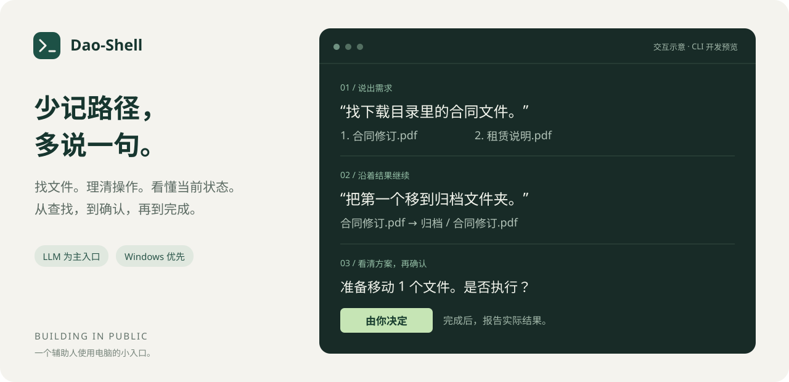

# Dao-Shell

[English](README.md) · [简体中文](README.zh-CN.md)

**用一句话，开始操作你的电脑。**

找到本机文件，了解电脑状态，沿着真实结果继续操作。Windows 桌面预览把电脑概览、会话和文件搜索放在一起；独立 CLI 另提供带确认和记录的小批量移动。

[下载 Windows v0.1.0](https://github.com/kestiny18/Dao-Shell/releases/tag/v0.1.0) · [开始体验](docs/GETTING_STARTED.zh-CN.md) · [文档导航](docs/README.md) · [路线图](ROADMAP.md) · [反馈场景](https://github.com/kestiny18/Dao-Shell/issues/new?template=use_case.yml)

*上图是交互示意，不是运行截图。文件移动属于 CLI 能力；桌面支持简体中文和英文，CLI 文案仍为中文。*

## 可以试些什么

| 任务 | Windows 桌面 | CLI |
| --- | --- | --- |
| 查找文件 | 有可用模型时理解自然语言，否则按文件名搜索 | 自然语言和直接搜索命令 |
| 打开当前结果 | 直接点击交系统默认应用，无第二次应用确认 | 本地选择，或模型请求后确认 |
| 了解电脑 | CPU/内存双榜、磁盘、网络接口、登记应用和精简电脑档案 | 资源及进程观测 |
| 结束进程 | 仅明确本地确认后操作可核验的当前用户实例 | 不提供 |
| 移动少量文件 | 不提供 | 展示方案、确认、同卷移动并记录回执 |

桌面有固定“概览”标签、独立会话标签、可恢复的可见历史，以及模型、权限、主题和语言设置。关闭标签保留会话；重启不会重放工具，也不会恢复旧候选和确认。

界面默认跟随 Windows 用户界面语言：中文系统显示简体中文，其余或未知显示英文。可在 **设置 → 通用与外观 → 界面语言** 手动选择并保存；手动选择优先。用户文字、自定义会话标题、路径和应用名不翻译。新模型请求遵循所选语言；用户明确要求其他语言时优先。

## 搜索与权限

受限访问只查找已选择、已授权的目录。完全访问默认使用版本匹配的索引组件，在受支持的本机固定 NTFS 卷上发现文件名称。首次安装和服务管理需要明确本地操作及 Windows 管理员权限；桌面本身保持普通权限，启动和搜索不自行安装或弹出提权。

服务缺失、不匹配或不可用时，只在回执列出的兼容目录内搜索。复杂筛选也使用有界目录查询，不忽略条件。覆盖可能不完整，回执说明范围、发布时间和卷失败。名称发现不授予查看或打开权限，后续动作仍重新核验访问范围与文件身份。

直接点击当前候选使用系统默认 `open` 处理程序，包含 HTML 和可执行文件；EXE 可能按 Windows 普通语义运行。模型发起打开仍需本地确认。结束进程另需确认，可能丢失未保存内容；受保护、身份变化或无法核验的对象拒绝操作。应用“卸载”只打开 Windows 设置，不执行注册表卸载命令。

## 当前阶段

这是 **Windows 10/11 x64 未签名开发预览**，不是稳定版，也没有完成独立完整验收。已构建约 9.1 MB 的本地安装包，内置小型 WebView2 引导程序；已有运行环境会复用，缺少时需联网从微软下载。缺少运行环境且无法联网时，需要先安装独立运行环境。

从 [v0.1.0 发布页](https://github.com/kestiny18/Dao-Shell/releases/tag/v0.1.0) 下载安装包和 SHA256 校验文件，或按 [桌面开发说明](desktop/README.md) 构建。发布说明列出来源提交、验证范围和已知限制；发行安装包从打标签的源码重新构建，之前本地 P13 包保留为历史试用证据。

实现、自测与实机证据分别记录。另一台 Windows 的“基本可用”为用户反馈，其中 C/E 卷持续更新失败仍为 **NOT_REPRODUCED**，不能说已经修复。真实服务升级、回滚、重启与干净机器安装等证据尚不完整；查询耗时优化已暂缓。见 [索引服务当前计划](docs/plans/2026-10-10-p11-windows-index-service.md)、[试用反馈记录](docs/devlog/2026-10-14-p12-trial-feedback.md) 和 [双语记录](docs/devlog/2026-10-15-p13-desktop-bilingual.md)。

## 开始试用与反馈

从 [体验指南](docs/GETTING_STARTED.zh-CN.md) 开始，先用虚构或可丢弃文件。文件名搜索无需模型。自然语言会把输入及相关名称、路径、元数据发送给所选模型服务；本地搜索和概览不自动调用模型，这些工具不读取文件正文。

欢迎描述具体场景、操作步骤、期望和实际结果。分享截图或诊断材料前移除密钥和私人路径。

[提交问题](https://github.com/kestiny18/Dao-Shell/issues/new/choose) · [参与贡献](CONTRIBUTING.md) · [开发记录](docs/devlog/README.md)

**项目：** Dao-Shell · **命令：** `daosh` · **提示符：** `dao >` · **Cargo 包名：** `dao-shell`

维护者：[kestiny18](https://github.com/kestiny18)。Copyright 2026 kestiny18。采用 [Apache License 2.0](LICENSE)。
